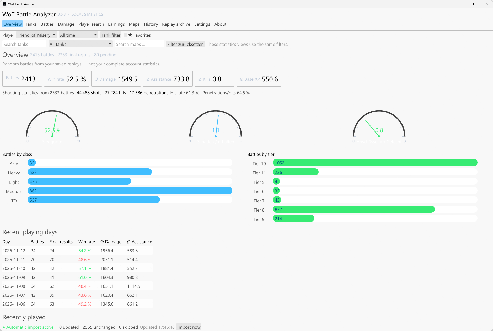
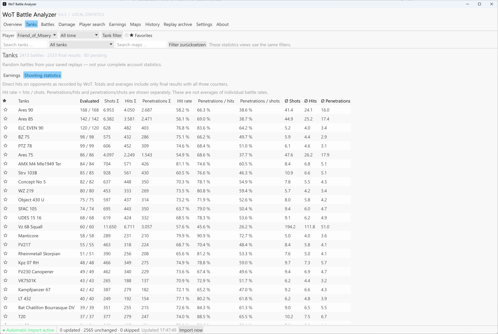
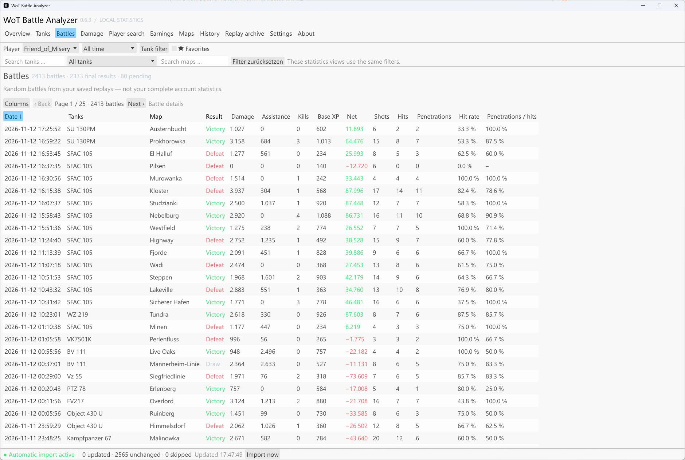
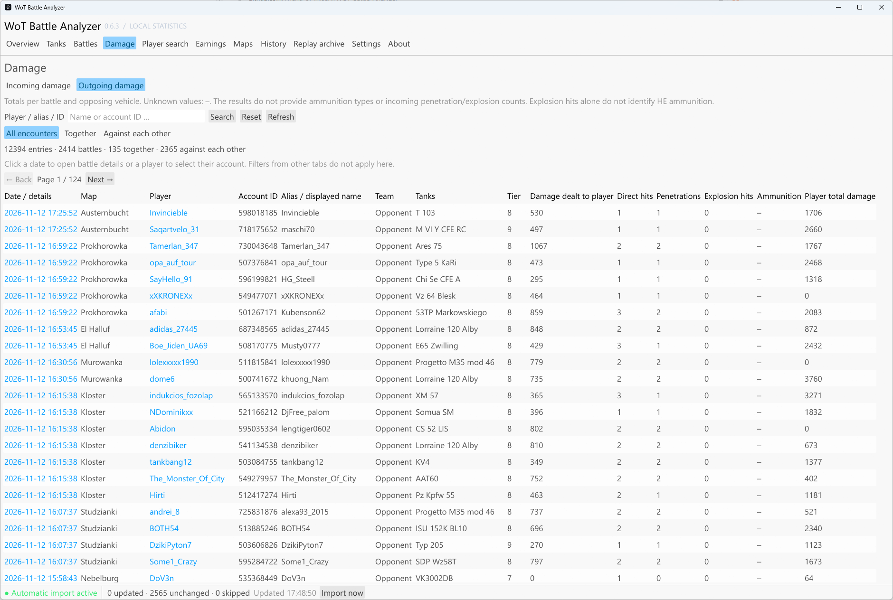

# WoT Battle Analyzer

A World of Tanks statistics tracker for Windows, created by **Friend of Misery**. Analyzes local replays to show which maps and tanks you perform best with.

## Download for Windows

**[Download WoT-Battle-Analyzer.exe](https://github.com/Friend-of-Misery/WOT-Battle-Analyzer/releases/latest/download/WoT-Battle-Analyzer.exe)** — Windows x64, no Rust installation required.

[All releases and ZIP downloads](https://github.com/Friend-of-Misery/WOT-Battle-Analyzer/releases/latest)

## Screenshots

| Overview | Tank statistics |
| --- | --- |
| [](screenshoots/Overview.png) | [](screenshoots/Tanks.png) |
| **Battle history** | **Outgoing damage** |
| [](screenshoots/Battles.png) | [](screenshoots/DMG_received.png) |

## Features

- Overview of win rate, damage, assistance, and battle history.
- Statistics by tank, class, tier, map, and date range.
- Battle details, credit balance, shot statistics, and player search.
- Automatic replay import, local archive, and custom SQL queries.
- Interface available in 13 languages.

## Getting started

Download and run `WoT-Battle-Analyzer.exe`.

Select your game and replay folders under **Settings**, then start an import. Enable recording of all battles in the game settings.

Statistics cover random battles from `.wotreplay` files. Missing final results are treated as unknown. All data stays on your computer; no login is required.

## Development

```powershell
cargo test
cargo build --release
```

GitHub Actions tests and builds every push to `main`. To publish a release, push a tag matching the version in `Cargo.toml` (for example, `v0.6.3`). The release includes the Windows x64 executable, a ZIP, and SHA-256 checksums.

Technical details: [Architecture](docs/architecture.md) (in German).

## License

Copyright (C) 2026 Friend of Misery. Licensed under [GNU GPLv3](LICENSE) (GPL-3.0-only). Third-party components retain their own licenses.

Inspired by [WoT Numbers](https://github.com/KIHestad/WotNumbers), an MIT-licensed project. This application is an independent Rust implementation.

Independent project. World of Tanks is a trademark of Wargaming.
